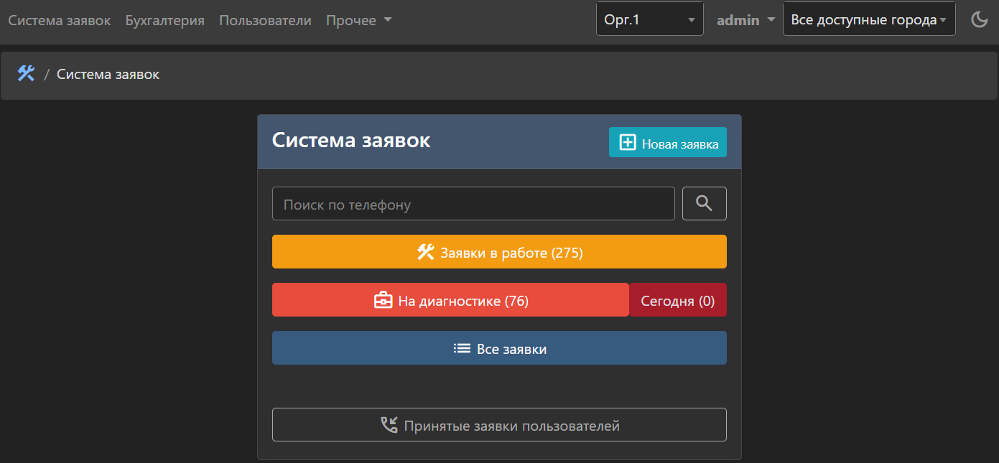
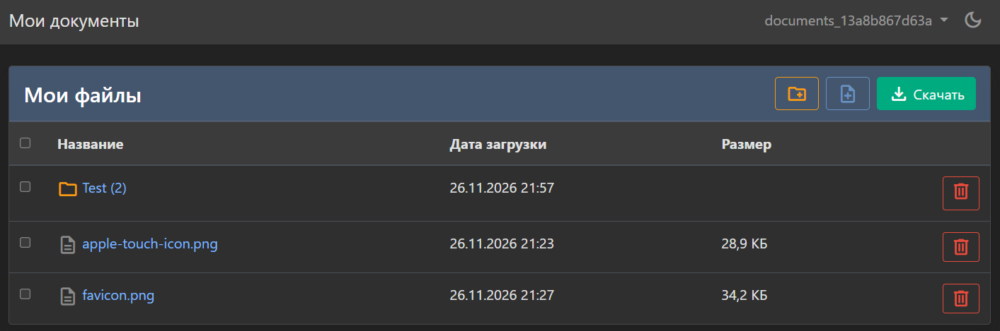

# Template Project

**Template Project** — CRM-система для сервисного центра по ремонту техники. Проект объединяет управление заявками,
клиентами, правами доступа, уведомлениями, статистикой и бухгалтерией.

Основная задача системы — организовать полный цикл работы с заявками на ремонт: от создания и назначения ответственных
до отслеживания статуса, уведомления пользователей и анализа результатов работы.

Проект также демонстрирует архитектурные решения на Django: разделение данных организаций по отдельным базам данных,
асинхронную обработку задач, планировщик фоновых операций и работу с файловым хранилищем.

## Возможности

- **Управление заявками:** создание и обработка заявок на ремонт техники, изменение статусов и отслеживание истории
  работы.
- **Права доступа:** разграничение возможностей пользователей в зависимости от назначенных ролей.
- **Мультитенантность:** отдельная база данных для каждой организации при едином наборе пользователей.
- **Уведомления:** информирование пользователей об изменениях заявок и других событиях.
- **Статистика:** сбор и отображение данных о работе сервисного центра.
- **Бухгалтерия:** учёт доходов и расходов.
- **Файловое хранилище:** загрузка, организация, скачивание и удаление документов.
- **Фоновые задачи:** выполнение длительных и периодических операций через Dramatiq и APScheduler.

## Скриншоты

### CRM



### Файловое хранилище



## Архитектура проекта

### Приложения

| Приложение              | Назначение                                                          |
|-------------------------|---------------------------------------------------------------------|
| `identity`              | Авторизация и управление пользователями                             |
| `accounts`              | Роли, права доступа и разграничение возможностей пользователей      |
| `apps.service_requests` | Создание и обработка заявок на ремонт техники, управление статусами |
| `apps.notifications`    | Формирование и отправка уведомлений                                 |
| `apps.statistics`       | Сбор и отображение статистики                                       |
| `apps.bookkeeping`      | Учёт доходов и расходов                                             |
| `documents`             | Асинхронное файловое хранилище                                      |

### Разделение баз данных

Одна из ключевых особенностей проекта — разделение данных организаций по отдельным базам данных.

Используется следующая схема:

- `default` — общие данные системы, в том числе пользователи и служебная информация.
- `organization_1`, `organization_2` и последующие базы — данные соответствующих организаций.

Таким образом, пользователи хранятся централизованно, а рабочие данные организаций изолированы друг от друга.

Для маршрутизации запросов между базами данных используется собственный `OrganizationRouter`. Контекст текущей
организации определяется в middleware.

Такой подход позволяет добавлять новые организации без необходимости создавать для каждой отдельный экземпляр
приложения.

### Фоновые задачи

Для выполнения фоновых задач используется **Dramatiq** с брокером RabbitMQ.

Периодические задачи регистрируются через **APScheduler**. Планировщик не выполняет длительные операции самостоятельно,
а передаёт задачи в очередь Dramatiq.

Redis используется для кеширования и хранения результатов фоновых задач в соответствующих окружениях.

### Файловое хранилище

Приложение `documents` реализовано на асинхронных представлениях и ORM Django.

Основные возможности:

- самостоятельная регистрация и авторизация пользователей;
- загрузка файлов в S3-совместимое хранилище;
- сжатие изображений перед сохранением;
- организация файлов по папкам;
- скачивание отдельных файлов и ZIP-архивов.

Приложение намеренно оставлено в составе проекта, хотя в дальнейшем его можно выделить в самостоятельный сервис.

### Автоматическое тестирование (GitHub Actions)

В проекте настроен **GitHub Actions Workflow**, который автоматически запускает тесты при каждом push-коммите в
репозиторий.

Это позволяет проверять работоспособность проекта после каждого изменения и своевременно обнаруживать ошибки, не
допуская попадания неработающего кода в основную ветку.

## Технологический стек

- **Python 3.11**
- **Django 5.2**
- **PostgreSQL 17**
- **Redis**
- **RabbitMQ**
- **Dramatiq**
- **APScheduler**
- **aioboto3**
- **Bootstrap 4**
- **jQuery**
- **Docker / Docker Compose**
- **Nginx**
- **MinIO / S3**

## Локальный запуск

Ниже описан запуск проекта непосредственно на локальной машине без Docker.

### 1. Требования

Перед началом работы установите:

- Python 3.11;
- PostgreSQL 17;
- Git.

Для полноценной работы фоновых задач также потребуется RabbitMQ. Redis понадобится при использовании соответствующих
настроек кеширования и брокера результатов.

### 2. Клонирование проекта

```bash
git clone https://github.com/golovin12/template_project.git
cd template_project
```

### 3. Создание виртуального окружения

Windows:

```powershell
python -m venv venv
venv\Scripts\activate
```

Linux / macOS:

```bash
python3.11 -m venv venv
source venv/bin/activate
```

### 4. Установка зависимостей

```bash
python -m pip install --upgrade pip
pip install -r requirements.txt
```

### 5. Настройка переменных окружения

Создайте файл:

```text
int/management/envs/.env
```

В нём задаются переменные окружения, используемые настройками проекта.

Пример:

```dotenv
DJANGO_SECRET_KEY=your-secret-key

TELEGRAM_INFO_BOT_SECRET=
TELEGRAM_INFO_BOT_USERNAME=
TELEGRAM_INFO_BOT_TOKEN=
TELEGRAM_ADMIN_BOT_TOKEN=
TELEGRAM_ADMIN_CHAT_ID=

VK_INFO_BOT_SECRET=
VK_INFO_BOT_GROUP_ID=
VK_INFO_BOT_TOKEN=
```

Переменные Telegram и VK необходимы для соответствующих интеграций. Если интеграции не используются, их можно не
заполнять.

### 6. Настройка PostgreSQL

Создайте пользователя PostgreSQL или используйте существующего пользователя с правами на создание баз данных.

В локальных настройках по умолчанию используются:

| Параметр     | Значение    |
|--------------|-------------|
| Пользователь | `postgres`  |
| Пароль       | `postgres`  |
| Хост         | `127.0.0.1` |
| Порт         | `5432`      |

Настройки баз данных находятся в `int/settings.py`.

По умолчанию используются следующие базы:

```text
template_project_default
template_project_organization_1
template_project_organization_2
```

При необходимости измените параметры подключения в `DATABASES` файла `int/settings.py`.

### 7. Создание баз данных и миграции

Проект содержит собственную management-команду для создания отсутствующих баз данных.

```bash
python manage.py create_databases
```

После создания баз выполните миграции для каждого подключения:

```bash
python manage.py migrate --database=default
python manage.py migrate --database=organization_1
python manage.py migrate --database=organization_2
```

При добавлении новой организации необходимо также зарегистрировать её подключение в `DATABASES` и выполнить миграции для
соответствующей базы.

### 8. Создание администратора

```bash
python manage.py createsuperuser
```

### 9. Запуск Django

```bash
python manage.py runserver
```

После запуска приложение будет доступно по адресу:

[http://127.0.0.1:8000](http://127.0.0.1:8000)

### 10. Запуск фонового обработчика

Для обработки задач Dramatiq:

```bash
python manage.py rundramatiq --processes 2 --threads 2 --queues holding_connection backup notifications statistics default
```

Для отдельной очереди уведомлений:

```bash
python manage.py rundramatiq --processes 1 --threads 2 --queues notifications_queue
```

В базовых локальных настройках используется `StubBroker`, поэтому одного запуска worker недостаточно для полноценной
работы распределённой очереди.

### 11. Запуск планировщика

```bash
python manage.py scheduler
```

Планировщик регистрирует периодические задачи и передаёт их на выполнение через Dramatiq.

Для корректной работы периодических задач должен быть запущен worker.

---

## Запуск Stage-окружения

В проекте предусмотрен отдельный набор настроек `int.settings_stage`.

Stage-конфигурация рассчитана на запуск в контейнерном окружении.

### 1. Подготовка переменных окружения

Базовые настройки загружают файл:

```text
int/management/envs/.env
```

Для Stage также можно передавать переменные через окружение контейнеров.

### 2. Запуск сервисов

Текущий `docker-compose-stage.yml` ориентирован на Stage: он задаёт `int.settings_stage`, использует MinIO, как
альтернативу S3.

Запуск выполняется стандартной командой:

```bash
docker compose -f docker-compose-stage.yml up -d --build
```

---

## Production

В репозитории уже присутствует `docker-compose.yml`, который описывает основные компоненты Production-инфраструктуры:

- Nginx с SSL;
- Django ASGI-приложение на Uvicorn;
- PostgreSQL;
- Redis;
- RabbitMQ;
- Dramatiq workers;
- APScheduler;
- Certbot для управления SSL-сертификатами.

Перед запуском необходимо подготовить `.env`, `.env.production`, настроить домен, хранилище и параметры инфраструктуры.

Запуск:

```bash
docker compose up -d --build
```

Для Production необходимо использовать собственные надёжные пароли, секретные ключи и учётные данные внешних сервисов.
Значения по умолчанию из исходных настроек не предназначены для реального развертывания.

## Структура проекта

```text
template_project/
├── apps/
│   ├── bookkeeping/
│   ├── notifications/
│   ├── service_requests/
│   └── statistics/
├── accounts/
├── common_tools/
├── documents/
├── identity/
├── int/
│   ├── management/
│   │   ├── commands/
│   │   ├── configurations/
│   │   └── envs/
│   ├── settings.py
│   ├── settings_stage.py
│   └── settings_production.py
├── requirements.txt
├── Dockerfile
└── docker-compose.yml
```
